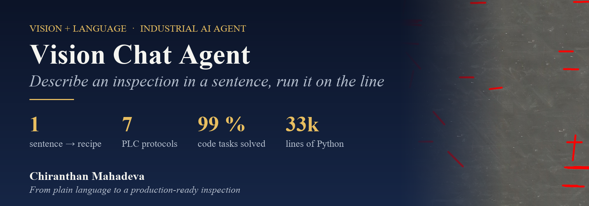
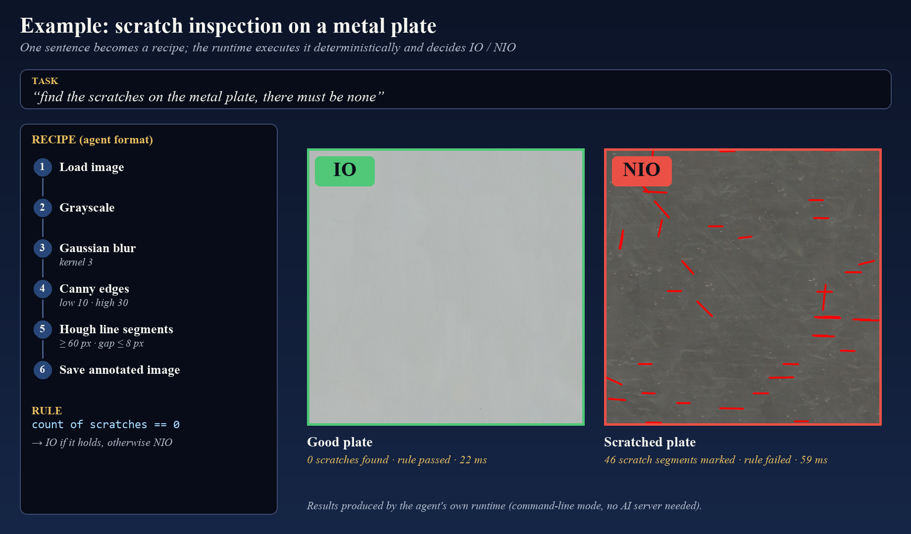
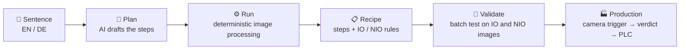
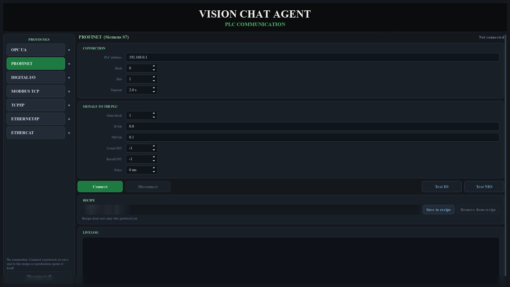
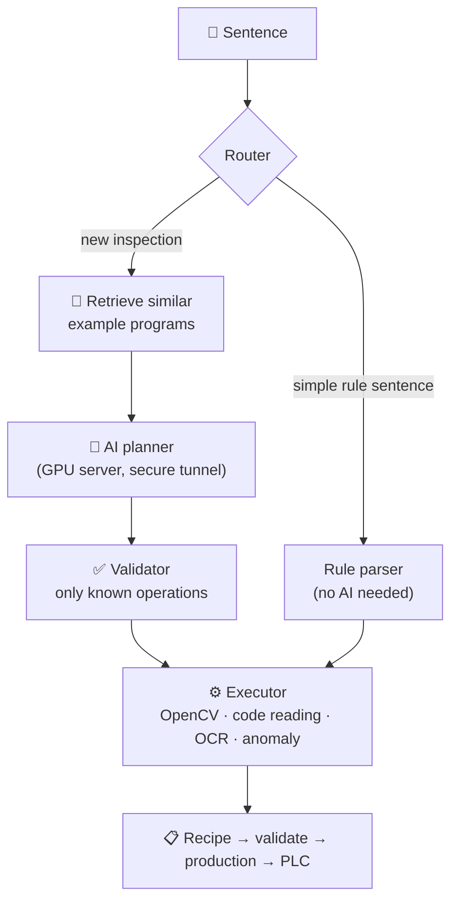

  

  
  
  
  

  <b>A desktop application I built that turns one sentence into a working machine-vision inspection, 
  validates it on test images, and runs it in production with a camera and a PLC.</b>

> **Source code is private.** It was built in an industrial setting. This page shows what I built and how, with my own example: scratch inspection on a metal plate (photos: CC0, Wikimedia Commons).

---

## 🎯 The idea

Setting up a vision inspection normally means an expert choosing filters, tuning thresholds and wiring the result to the machine.
With this agent, the operator just **types what they want**:

> *"find the scratches on the metal plate, there must be none"*

The agent **plans the inspection steps**, **runs them**, and turns the acceptance criterion in the sentence ("there must be none") into an **IO / NIO condition** automatically. The result is a **recipe** that runs without the AI, on the production line.

The recipe above is written in the agent's recipe format for this page. The IO / NIO images, counts and timings are real outputs of the agent's runtime: 0 scratches on the good plate, 46 marked segments on the scratched one.

## 🧭 From sentence to production

**Key design choice: the AI plans, but it never measures.**
A self-hosted vision-language model drafts the inspection as a list of steps. The steps are then executed by **deterministic image-processing code**, so every result is reproducible, and a saved recipe needs **no AI server at all** in production.

## 🖥️ What I built: the pages

| Page | What it does |
|---|---|
| **CAMERA** | Connect industrial cameras, set exposure, trigger and region of interest; zoom with pixel read-out |
| **CHAT** | Type the task, pick an image or camera capture, get the planned and executed result |
| **PROGRAM** | See the recipe as a **flow chart**, adjust each step's parameters, edit IO / NIO conditions |
| **VALIDATE** | Recipe library and **batch test** over folders of good and bad images before going live |
| **PLC COMMUNICATION** | Send verdict, count and result to the machine |
| **PRODUCTION** | Software or continuous trigger, live verdict, frame history, IO / NIO statistics |
| **HISTORY** | Every run, searchable |

### Talks to the machine: 7 protocols

**OPC UA · PROFINET (Siemens S7) · Modbus TCP · TCP/IP · EtherNet/IP · EtherCAT · camera digital I/O.** The IO / NIO bits, object count and result code go straight to the PLC, and each recipe remembers its own connection.

## 🏗️ Under the hood

- **Retrieval-augmented planning:** a knowledge base of example programs guides the AI planner.
- **Validator:** the plan may only use whitelisted operations, so the model can't produce arbitrary code.
- **Code generation and deployment packages:** a validated recipe can be **exported as a stand-alone package** and run on another PC without the application.
- **Works without the server:** recipes, validation, production and PLC communication run fully offline. Only designing a *new* inspection needs the AI.
- **Secure server link:** the application opens an encrypted tunnel to the GPU server by itself.

## 📊 Tested at scale

Before a trade-fair demo I built an **automatic evaluation**: thousands of randomly generated task sentences (different wordings, typos, English and German) run against real demo images. Live results on 5,431 sentences:

| Task family | Correct |
|---|:--:|
| Reading barcodes and QR codes | **99.0 %** |
| Shape questions | **93.0 %** |
| Dice counting and reading | **81.9 %** |

Plus a **regression self-test** that runs after every installation, and planner evaluation sets that track quality from version to version.

## 📦 Delivered like a product

- **Offline installer**: Python runtime and all packages bundled, no internet needed.
- **Self-test** that must pass after installation.
- A full **user guide** in English and German, with screenshots.
- **Example material**: IO / NIO image sets, printable demo cards and an example deployment package.

## 💡 What I learned

1. **Let the AI plan, let code measure.** Language models are great at *understanding the task*; deterministic code is what you can certify on a production line.
2. **A recipe beats a chat.** Turning the conversation into a saved, validated recipe made the result usable without the AI.
3. **Measure the AI like a product.** Thousands of generated sentences found weaknesses that a handful of demos never would.
4. **Integration is half the product.** Cameras, seven PLC protocols, offline install and deployment packages are what make an AI demo a real tool.

## 🧰 Tech stack

**Python** · **PyQt5** desktop GUI · self-hosted **vision-language model** on a GPU server · retrieval (vector store + SQLite) · **OpenCV** · code reading and OCR · anomaly detection · industrial camera SDKs · PLC libraries (OPC UA, S7, Modbus, EtherNet/IP, EtherCAT) · offline installer

---

  <b>Chiranthan Mahadeva</b> · Industrial machine vision & AI 
  More: <a href="https://github.com/Gojoinferno/VisionSuite-NoCode">VisionSuite-NoCode</a> ·
  <a href="https://github.com/Gojoinferno/MachineVision-Research">MachineVision-Research</a> ·
  <a href="https://github.com/Gojoinferno/OPCUA-PLCVisionBridge">OPCUA-PLCVisionBridge</a>

